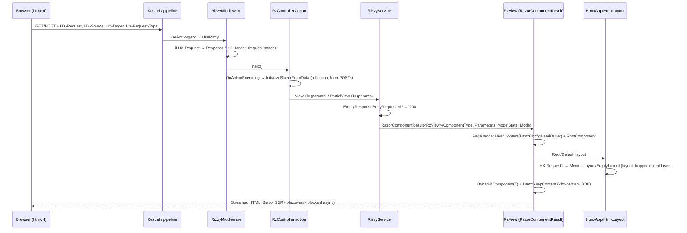
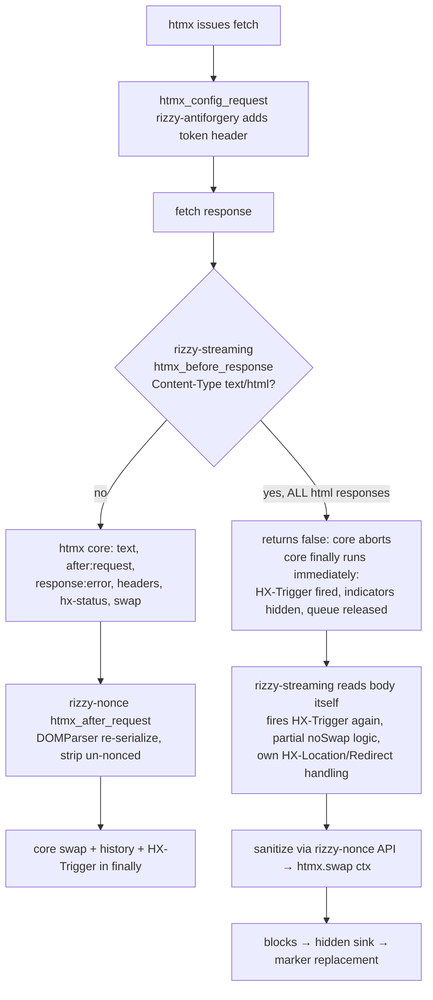

# 01 — Repository and Architecture

| Field | Value |
|---|---|
| Audit | Rizzy initial audit, 2026-11-08 |
| Repository / commit | https://github.com/JalexSocial/Rizzy @ `7e3f0f1126ee412d9db4f37d13d0370159edac15` (`main`) |
| Scope | Inventory, project responsibilities, dependencies, architecture, request lifecycle, extension points |
| Methodology / limitations | See [00-executive-summary.md](00-executive-summary.md#methodology) |

## 1. Repository inventory

| Item | Value |
|---|---|
| Branch / HEAD | `main` @ `7e3f0f1` (2026-06-09). 257 commits. Last tag `v5.2.0`, so 5.3.0 and 5.4.0 are untagged |
| Other branches | `dev`, `four`, `mat-htmx4-migration`, `mat-feat-sourcegen`, `mat-experimental-renderer`, `merge-htmxor-changes`, remote `codex/migrate-rizzy-repository-to-htmx-4.0` |
| Working tree | Clean, except untracked `.serena/` (IDE/agent tool state) |
| Tracked files | 289. About 8k lines of library C#, 870 lines of client JS |
| Solution | `src/Rizzy.sln`, 5 projects. It also contains a stale configuration block for a non-existent project GUID `{483780E3-…}` |
| `global.json` / `Directory.Build.props` | None. The SDK floats, and there are no shared build properties |
| License | MIT |

### Projects

| Project | Type | TFM | Lang | Packable | Version | Responsibility |
|---|---|---|---|---|---|---|
| `src/Rizzy.Htmx` | Class library | net10.0 | default (C# 14) | Yes, `Rizzy.Htmx` | **5.3.0** | htmx protocol layer: request/response headers, config model, swap/trigger builders, MVC attributes, antiforgery options, JSON source-gen context |
| `src/Rizzy` | Razor class library | net10.0 | default | Yes, `Rizzy` | **5.4.0** | Razor-component rendering for MVC/minimal APIs (`RzView`, `IRizzyService`, `RzController`), layouts, OOB swap service, form components, nonce provider, middleware, static JS assets |
| `src/Rizzy.SourceGenerators` | Roslyn incremental generator | netstandard2.0 | latest | **No** (`IsPackable=false`) | n/a | Generates `Params` helper classes for components marked `[RizzyParameterize]` |
| `src/RizzyDemo` | ASP.NET Core web app | net10.0 | default | No | n/a | Demo/sample (MVC controller, Razor component views) |
| `test/Rizzy.Tests` | xUnit tests | net10.0 | default | No | n/a | 55 tests. Mostly `Rizzy.Htmx` header and builder tests, plus one bUnit component test |
| `packages/rizzy` | npm package `@jalexsocial/rizzy` | ES2020 UMD via Vite | JS | Yes (npm) | 5.4.0 | htmx 4 extensions: `rizzy-nonce`, `rizzy-streaming`, `rizzy-antiforgery`, `rizzy-confirm`. The Vite build copies `dist/` into `src/Rizzy/wwwroot/` |

### NuGet dependencies (direct)

| Project | Package | Version | Notes |
|---|---|---|---|
| Rizzy | `Sqids` | 3.2.0 | Used only by `IdGenerator` for form-input IDs |
| Rizzy, Rizzy.Htmx | `DotNet.ReproducibleBuilds` | 1.2.39 | Private build asset |
| Rizzy | `DefaultDocumentation` | 1.2.2 | Private. XML doc generation is disabled (`GenerateDocumentationFile=false`), so this is effectively unused |
| SourceGenerators | `Microsoft.CodeAnalysis.CSharp` 5.0.0, `Microsoft.CodeAnalysis.Analyzers` 3.11.0 | | Compile-time only |
| Demo | `Humanizer.Core` 3.0.1 | | |
| Tests | `xunit` 2.9.3, `xunit.runner.visualstudio` 3.1.5, `Microsoft.NET.Test.Sdk` 18.0.1, `bunit` 2.3.4, `FluentAssertions` 7.0.0 (+ analyzers 0.34.1), `Alba` 8.4.0, `System.IdentityModel.Tokens.Jwt` 8.15.0, `SystemTextJson.JsonDiffPatch.Xunit` 2.0.0, `coverlet.collector` 6.0.4 | | `Alba` and the JWT package appear unused by any test. Transitive `AngleSharp` 1.4.0 (via bUnit) has a moderate advisory |

### JavaScript dependencies (`packages/rizzy`)

| Package | Declared | Locked | Kind | Notes |
|---|---|---|---|---|
| `htmx.org` | `^4.0.0-beta4` | 4.0.0-beta4 | dependency | Not bundled: extensions use the global `htmx`. This should be a peer dependency. Current release is 4.0.1 |
| `aspnet-client-validation` | `^0.11.1` | 0.11.1 | dependency | **Not imported** since validation was removed from the bundle |
| `vite` | `^6.3.5` | 6.4.3 | dev | npm audit: high (dev-only) |
| `jsdom`, `fs-extra`, `rollup-plugin-visualizer` | | | dev | |

`src/Rizzy/package.json` declares only `repomix` (dev). It generates `src/Rizzy/llmquery.txt`, a 3,183-line source dump committed to the repo.

### Build, generation, CI, docs

| Area | State |
|---|---|
| MSBuild client integration | `Rizzy.csproj` defines `EnsureClientAssets` → `InstallClientPackages` (`npm ci`) → `BuildClientAssets` (`npm run build`), plus `LLM` (`npm run llm`). They are hooked only when `$(TargetFramework)` is empty, which never happens for a single-TFM project. **They never run** (verified: no npm output in the build log). See RIZZY-023 |
| Source generators | `RizzyParameterGenerator` (runs in Rizzy and RizzyDemo via `ProjectReference OutputItemType=Analyzer`). STJ source generator for `HtmxJsonSerializerContext` |
| CI | One workflow, `.github/workflows/dotnet.yml`. It runs on push to `main` only: build, publish, (no-op) test, pack, push to NuGet, then build and publish npm. See RIZZY-010 |
| Release | Version is hand-edited in each csproj. The npm version is copied from `Rizzy.csproj` at publish time. There is no changelog, and recent releases are untagged |
| Docs | Root `README.md` (marketing, no setup), `src/Rizzy.Htmx/README.md`, `packages/rizzy/README.md`, `CONTRIBUTING.md`, `CODE-OF-CONDUCT.md`. The external site is `jalexsocial.github.io/rizzy.docs`. There was no `docs/` content apart from `docs/media` |

## 2. Project dependency graph

```mermaid
graph LR
  subgraph NuGet
    RH[Rizzy.Htmx 5.3.0<br/>protocol helpers]
    R[Rizzy 5.4.0<br/>Razor/MVC integration]
  end
  SG[Rizzy.SourceGenerators<br/>netstandard2.0, not packed]
  JS[@jalexsocial/rizzy<br/>JS htmx extensions]
  D[RizzyDemo]
  T[Rizzy.Tests]
  ASP[Microsoft.AspNetCore.App<br/>framework ref]
  HTMX[htmx.org 4.x<br/>loaded by app]

  R --> RH
  R -. analyzer .-> SG
  R --> ASP
  RH --> ASP
  R -- wwwroot/js copied from --> JS
  JS -. global htmx .-> HTMX
  D --> R
  D -. analyzer .-> SG
  T --> R
  T --> RH
  RH -. InternalsVisibleTo .-> R
```

Dependencies point the right way: Rizzy → Rizzy.Htmx → ASP.NET Core. `Rizzy.Htmx` does depend on MVC abstractions (`IActionConstraint`, `IResultFilter`) and on `Microsoft.AspNetCore.Components.Forms` (`EditContext` in `HttpContextExtensions`). That makes the "protocol" package heavier than it needs to be, but this is acceptable given the shared framework reference. `InternalsVisibleTo("Rizzy")` couples the packages tightly. `Rizzy` sets internal `HtmxConfig.DocumentNonce`/`Antiforgery`, which is why the two packages must be released in lockstep (RIZZY-001).

## 3. Core subsystems

| Subsystem | Key types (path) | Notes |
|---|---|---|
| Service registration | `AddHtmx` (`src/Rizzy.Htmx/ServiceCollectionExtensions.cs`), `AddRizzy` (`src/Rizzy/Extensions/ServiceCollectionExtensions.cs`) | Two independent entry points. `AddRizzy` does not call `AddHtmx` (RIZZY-026). `AddHtmx` registers antiforgery and uses reflection to register MVC internal antiforgery filters (RIZZY-020) |
| Middleware | `RizzyMiddleware` / `UseRizzy()` | Adds an `HX-Nonce` response header on htmx requests. Nothing else |
| Request model | `HtmxRequest`, `HttpRequest.Htmx()` (cached in `HttpContext.Items`), `IsHtmx()` | Header parsing |
| Response model | `HtmxResponse`, `HttpResponse.Htmx(...)`, `HtmxResponseAttribute`, `HtmxRequestAttribute` (action constraint) | Fluent header writers. `EmptyBody()` sets an Items flag that `RizzyService` turns into 204 |
| Rendering | `IRizzyService`/`RizzyService`, `RzController`, `RzControllerWithViews`, `RzView` (internal), `FragmentComponent` | Wraps the target component in `RzView` and returns `RazorComponentResult<RzView>` with streaming enabled |
| Layouts | `HtmxApp<T>`, `HtmxLayout<T>`, `EmptyLayout`, `MinimalLayout`, `EmptyRootComponent`, `RizzyConfig.RootComponent/DefaultLayout` | For any `HX-Request` the real layout is replaced with `<html><body>` or nothing (RIZZY-006) |
| Configuration | `HtmxConfig` (record, options), `HtmxConfigHeadOutlet` → `<meta name="htmx-config">`, `RizzyConfig` | The meta tag also carries Rizzy-specific `antiforgery` and `documentNonce` keys consumed by the JS |
| OOB swaps | `IHtmxSwapService`/`HtmxSwapService` (scoped), `HtmxSwapContent`, `HtmxSwappable` → `<hx-partial hx-target hx-swap>` | Rendered after every view; only emitted for htmx requests |
| Forms and validation | `RzInput*Base`, `RzValidationMessageBase`, `RzValidationSummaryBase`, `DataAnnotationsProcessor` (singleton), `RzModelStateProvider`, `RzInitialValidator`, `InitializeBlazorFormData` | Emits `data-val-*` attributes for unobtrusive validation and bridges MVC `ModelState` into `EditContext`. The client validation library is no longer bundled |
| Security helpers | `IRizzyNonceProvider`/`RizzyNonceProvider` (scoped, 32-byte CSPRNG), `HtmxAntiforgeryOptions`, `AntiforgeryStrategy` | |
| Utilities | `IdGenerator` (Sqids), `ObjectExtensions` (`ToDictionary`, `SerializeAsAlpineData`), `RenderFragmentExtensions`, `EnumMemberJsonConverter` (unused) | |
| Code generation | `RizzyParameterGenerator` | Generates `Params` constants and helpers |
| Client JS | `packages/rizzy/src/js/*.js` | 4 htmx extensions, auto-registered on load (RIZZY-003/004/005) |

## 4. Request-processing lifecycle

### Server side (MVC action returning a Rizzy view)



The key decision point is that `HtmxLayout<T>` decides between "full layout" and "fragment" from the **presence of `HX-Request` alone**. It ignores `HX-Request-Type` and `HX-History-Restore-Request` (RIZZY-006).

### Client side (htmx 4.0.1 with Rizzy extensions)



Because nearly all Rizzy responses are `text/html`, the **left branch is effectively never taken**. Rizzy apps run on a partial re-implementation of htmx's response pipeline (RIZZY-003).

## 5. Extension points

| Extension point | Mechanism | Assessment |
|---|---|---|
| htmx config | `AddHtmx(cfg => …)` / `IOptions<HtmxConfig>` | Good. It uses the standard options pattern, but some keys are stale (RIZZY-028) |
| Rizzy config | `AddRizzy(cfg => …)`: root component, default layout, antiforgery strategy | Reasonable. Validation throws plain `Exception` |
| Nonce provider | Replace `IRizzyNonceProvider` (`TryAddScoped`) | Good |
| Validation attributes | `DataAnnotationsProcessor.AddAttributeHandler<T>()` | It's a singleton with mutable handler map and no thread-safety, and it's affected by RIZZY-008 |
| Rendering | `IRizzyService` (scoped, interface) | Good for testing and minimal APIs |
| Controllers | Inherit `RzController` / `RzControllerWithViews` (virtual methods) | Duplicated implementations (RIZZY-030) |
| OOB content | `IHtmxSwapService` | Good concept. The raw-markup API is a footgun (RIZZY-029) |
| JS | htmx extensions auto-register on script load. You can only "opt out" via htmx `extensions` allow-list config | The extensions are opinionated and always on. They aren't individually toggleable from Rizzy config (RIZZY-003/004/005) |

## 6. Architectural strengths

1. **Appropriately thin server core.** Rizzy composes `RazorComponentResult`, `DynamicComponent`, `LayoutView`, `HeadContent` and options instead of building a parallel rendering stack.
2. **Clean package layering**, with `Rizzy.Htmx` usable on its own by MVC/Razor Pages/minimal-API apps.
3. **Typed htmx protocol API.** Header constants, fluent builders and STJ source-generated serialization (AOT-friendly) are all in place.
4. **Security-minded defaults in intent**: automatic antiforgery tokens and nonce awareness.
5. **Small client footprint**, with a reproducible bundle.

## 7. Architectural weaknesses

1. **The client extensions override htmx core instead of extending it.** `rizzy-streaming` and `rizzy-nonce` intercept every response, so htmx 4 features (`hx-status`, error events, the `HX-Trigger` timing contract, request queueing) don't apply in Rizzy apps. This is the largest architectural risk (RIZZY-003, RIZZY-004).
2. **Layout selection uses the wrong signal.** htmx 4 introduced `HX-Request-Type: full|partial` precisely to decide between a full page and a fragment. Rizzy still uses "any htmx request means fragment" (RIZZY-006).
3. **Reliance on ASP.NET Core internals via reflection** for antiforgery filters and Blazor form-data binding (RIZZY-020).
4. **Release engineering is unreliable.** There are two separately versioned packages that must ship together, CI that publishes on every push, and generator and client-build integration that never ships or runs (RIZZY-001, -010, -022, -023).
5. **Two parallel setup entry points** (`AddHtmx`, `AddRizzy`) with an implicit ordering requirement, and a default root component that renders no `<head>` (RIZZY-026).

## 8. Is the architecture sized appropriately?

Mostly yes. The server side is not over-abstracted. These abstractions earn their keep: `IRizzyService`, `IHtmxSwapService`, `IRizzyNonceProvider`.

Abstractions that are unnecessary or dead:

- `HtmxContext`, which duplicates `HttpRequest.Htmx()` without caching.
- `ConfigureHtmxSettings`, which is empty.
- `TriggerSpecificationCache`, `EnumMemberJsonConverter`, `ScrollBehavior`, and `HtmxAntiforgeryOptions.CookieName`, which are unused.
- `AntiforgeryStrategy.None = 1`, an odd enum base.

Missing abstractions that would pay off:

- A request-classification helper: `IsPartial`, `IsFullPage`, `IsHistoryRestore`, as an enum rather than a string (RIZZY-017).
- A typed `HX-Location`/`htmx.ajax` options model aligned with htmx 4 (RIZZY-014).
- A switch to opt in to client extensions.

**Recommendation:** make targeted changes, not a rewrite. The server core needs fixes, not redesign. The JS extensions need a focused redesign around htmx 4's supported extension contract (`ctx.extensionPromise`, `inlineScriptNonce`, `hx-csp`).

## 9. Important technical debt (summary)

| Debt | Findings |
|---|---|
| Two packages versioned independently but coupled by `InternalsVisibleTo` | RIZZY-001 |
| Client extensions re-implement htmx internals and depend on internal `_htmx` element state | RIZZY-003, RIZZY-004 |
| Reflection on framework internals | RIZZY-020 |
| htmx 2-era builder syntax and config properties | RIZZY-007, RIZZY-013, RIZZY-028 |
| Dead MSBuild targets, unshipped generator, stale bundles in `wwwroot` | RIZZY-021, RIZZY-022, RIZZY-023 |
| Near-zero test coverage of the `Rizzy` package | RIZZY-025 |
| Committed generated/tooling artifacts (`llmquery.txt`, `stats.html`), stale solution entries | RIZZY-033 |
