# 06 — Prioritized Development Roadmap

| Field | Value |
|---|---|
| Audit | Rizzy initial audit, 2026-11-08 |
| Repository / commit | https://github.com/JalexSocial/Rizzy @ `7e3f0f1126ee412d9db4f37d13d0370159edac15` |
| Scope | Actionable plan synthesized from findings RIZZY-001 … RIZZY-033 |
| Status | **Proposal only. Nothing here is authorized for implementation until the project owner approves it.** |

## Effort scale and assumptions

| Effort | Meaning |
|---|---|
| **S** | Hours |
| **M** | About 1–2 development days |
| **L** | Several development days |
| **Major** | Needs separate design or planning |

Assumptions: one developer familiar with the codebase; .NET 10 SDK and Node 22 available; browser testing via Playwright is acceptable to add. Estimates exclude review and release coordination. Phases A and B together are expected to form **Rizzy 6.0.0**, a breaking release, with htmx 4.0.1+ as the only supported runtime (see [03 §6](03-htmx4-compatibility.md#6-compatibility-strategy-comparison)).

## Phase overview

```mermaid
gantt
  dateFormat  X
  axisFormat  %s
  section A Stabilize
  A1 Release graph fix        :a1, 0, 1
  A2 CI/CD overhaul           :a2, 0, 2
  A3 XSS fix                  :a3, 0, 1
  A4 Validation cache fix     :a4, 0, 1
  A5 HtmxResponseAttribute    :a5, 1, 1
  A6 Package contents         :a6, 1, 1
  A7 Regression test harness  :a7, 1, 3
  section B htmx 4
  B1 Streaming rework         :b1, after a7, 4
  B2 Nonce/CSP rework         :b2, after a7, 4
  B3 Confirm fallback         :b3, after a7, 1
  B4 Layout/history           :b4, after a7, 2
  B5-B8 Builders and headers  :b5, after a7, 3
  B9 Error strategy           :b9, after b4, 2
  B10-B11 Config and docs     :b10, after b5, 2
  section C-E
  C Architecture/API          :c, after b10, 4
  D Perf/reliability          :d, after b10, 2
  E DX/release quality        :e, after b10, 3
```

The Gantt units are relative ordering only, not calendar days.

---

## Phase A — Baseline stabilization

Fix what is broken for users today and build the safety net needed for Phase B.

### RM-A1 — Repair the NuGet release graph
- **Description:** Adopt lockstep versioning for Rizzy, Rizzy.Htmx and `@jalexsocial/rizzy`, with one version source (`Directory.Build.props`). Pin Rizzy's dependency on Rizzy.Htmx to the exact same version. *Owner actions:* deprecate Rizzy 5.4.0 on nuget.org with a message pointing to 5.3.x (htmx 2) or 6.0, and decide whether to publish an interim 5.4.1 pair.
- **Reason:** RIZZY-001 (P0). NuGet consumers of 5.4.0 get an incompatible Rizzy.Htmx.
- **Priority:** P0 · **Effort:** S (code), plus owner actions on nuget.org · **Depends on:** RM-A2, for publishing through a validated pipeline
- **Acceptance criteria:** A fresh `dotnet new web` + `dotnet add package Rizzy --version <new>` restores a Rizzy.Htmx built from the same commit. The app renders `HtmxSwappable` without type-load errors.
- **Verification:** A CI "consumer smoke test" job that packs to a local feed, creates a sample app from the packages (not project references), and runs a pipeline test.

### RM-A2 — Overhaul CI/CD
- **Description:** Split into `ci.yml` (PR + push: build, `dotnet test test/Rizzy.Tests`, `npm ci && npm test && npm run build:check`, a git-diff check that `wwwroot/js` matches a fresh build, pack plus a package-content check) and `release.yml` (tag or manual: version from tag, pack, push **without** `--skip-duplicate`, npm publish with provenance, GitHub Release). Remove `dotnet publish` from CI. Node 22. Restore PR triggers.
- **Reason:** RIZZY-010, RIZZY-021, RIZZY-023, RIZZY-024.
- **Priority:** P1 · **Effort:** M · **Depends on:** none
- **Acceptance criteria:** A PR with a failing test or stale `wwwroot` fails CI. Merging to `main` publishes nothing. Pushing tag `v6.0.0-preview.1` publishes both NuGet packages and npm at that version.
- **Verification:** Dry-run the release workflow against a test feed (GitHub Packages). Deliberately break a test in a draft PR.

### RM-A3 — Fix the `SerializeAsAlpineData` XSS
- **Description:** Replace `SingleQuoteStringConverter` with standard HTML-safe JSON output, or full JS string escaping. Add hostile-input tests. Prepare a GitHub security advisory.
- **Reason:** RIZZY-002 (P0).
- **Priority:** P0 · **Effort:** S · **Depends on:** none
- **Acceptance criteria:** The payload `\', x: alert(1)}//` and values with newlines, `
`, `</script>` produce strings that JS parses as a single string literal. The existing output stays valid for Alpine `x-data`.
- **Verification:** Unit tests. Optionally a Playwright test with Alpine that asserts no `alert` fires.

### RM-A4 — Fix the `DataAnnotationsProcessor` cache key
- **Description:** Key by `(Type, FieldName)`. Handle `AmbiguousMatchException` for shadowed properties.
- **Reason:** RIZZY-008 (P1).
- **Priority:** P1 · **Effort:** S · **Depends on:** none
- **Acceptance criteria:** For a model with `[Required] Name` and `[EmailAddress] Email`, each input renders only its own `data-val-*` attributes, regardless of render order.
- **Verification:** Unit tests on `MergeAttributes`. A bUnit test rendering `RzInputTextBase` for two fields.

### RM-A5 — Make `HtmxResponseAttribute` usable and non-throwing
- **Description:** Use non-nullable `bool` and `SwapStyle` properties. Make it a no-op for non-htmx requests. Revisit `AssertIsHtmxRequest` policy (log instead of throw, or make it configurable).
- **Reason:** RIZZY-009 (P1), RIZZY-030.
- **Priority:** P1 · **Effort:** S · **Depends on:** none · **Breaking:** source-compatible for existing string usages
- **Acceptance criteria:** `[HtmxResponse(Refresh = true, Reswap = SwapStyle.outerHTML)]` compiles. A non-htmx GET to the action returns 200.
- **Verification:** Compile test plus pipeline test.

### RM-A6 — Clean package contents
- **Description:** Delete `wwwroot/js/rizzy.es.*`. Make the Vite copy clean its destination. Exclude `package*.json`, `llmquery.txt` and `publish/**` from packing. Ship the XML documentation file.
- **Reason:** RIZZY-021, RIZZY-026 (IntelliSense).
- **Priority:** P2 · **Effort:** S · **Depends on:** RM-A2 (content check)
- **Acceptance criteria:** The `.nupkg` contains only `lib/`, `staticwebassets/js/rizzy.js|.min.js|.js.map`, `build*/`, readme, license and icon (plus `analyzers/` if RM-C2 ships it).
- **Verification:** CI package-content allow-list check.

### RM-A7 — Regression test harness
- **Description:** Add a pipeline test project (Alba is already referenced, or `WebApplicationFactory`) with a minimal Rizzy host. Add JS integration tests that load the real `htmx.org@4.0.1` (jsdom/happy-dom), plus a small Playwright suite against the demo for history, confirm, tables and streaming. Fix tests that encode htmx 2 syntax.
- **Reason:** RIZZY-025. It is also a prerequisite for safe Phase B changes.
- **Priority:** P1 · **Effort:** L · **Depends on:** RM-A2
- **Acceptance criteria:** The test list in [05 §3](05-testing-and-release.md#3-missing-regression-coverage--rizzy-025) is implemented, with tests currently failing for known defects marked as `Skip` with the finding ID. Rizzy package line coverage is at least 50%.
- **Verification:** CI runs all suites on every PR.

---

## Phase B — htmx 4 compatibility

### RM-B1 — Rework `rizzy-streaming` to cooperate with htmx 4 core
- **Description:** Take over only when the response actually streams (server signal header or `<blazor-ssr>` detection, else defer to core). When taking over, set `ctx.extensionPromise`, `clearTimeout(ctx.requestTimeout)`, and don't re-fire `HX-Trigger`/`finally`. Use core status handling (`hx-status`). Remove `HX-Trigger-After-*`. Drop reliance on `_htmx` internals.
- **Reason:** RIZZY-003 (P1), RIZZY-019, RIZZY-027(3).
- **Priority:** P1 · **Effort:** L (Major if the server signal requires Rizzy server changes, which is likely: a small header from `RzView` when streaming is active) · **Depends on:** RM-A7
- **Acceptance criteria:** For non-streaming responses: `htmx:after:request` and `htmx:response:error` fire, `hx-status:422` is honored, `HX-Trigger` fires exactly once after the swap, indicators stay until the swap completes, and `hx-sync` queues behave. For streaming responses: incremental `<blazor-ssr>` patching still works and the indicator stays until the stream ends.
- **Verification:** JS integration tests against 4.0.1 plus a Playwright streaming page in the demo.

### RM-B2 — Replace the nonce sanitizer with htmx-native CSP handling
- **Description:** Design note first (Major). Recommended approach: rely on `htmx.config.inlineScriptNonce` and the official `hx-csp` extension. Stop the `DOMParser` round-trip. If filtering is kept, use `<template>` parsing, run only when a nonce is configured, and filter scripts only. Avoid exposing the nonce in the meta attribute. Unify all swap paths.
- **Reason:** RIZZY-004 (P1), RIZZY-027.
- **Priority:** P1 · **Effort:** Major (design) + L (implementation) · **Depends on:** RM-A7, and coordinate with RM-B1
- **Acceptance criteria:** `<tr>`/`<td>` fragments swap intact. Un-nonced `<style>`/`<link>` survive when no CSP is configured. Nonced scripts at any position execute. Injected un-nonced scripts do not execute under a strict CSP.
- **Verification:** Fixture-based jsdom tests plus Playwright with a strict CSP header in the demo. Follow-up security review.

### RM-B3 — `rizzy-confirm` falls back to native confirm
- **Description:** Use the custom dialog only when opted in or when a listener handles the event. Otherwise let htmx use `window.confirm`.
- **Reason:** RIZZY-005 (P1).
- **Priority:** P1 · **Effort:** S · **Depends on:** none (tests via RM-A7)
- **Acceptance criteria:** Without a listener, `hx-confirm="Sure?"` shows the native dialog and proceeds on OK. With a listener, the custom flow works.
- **Verification:** JS unit test with a mocked `window.confirm`. Playwright test.

### RM-B4 — Layout selection from `HX-Request-Type` and history restore
- **Description:** `HtmxLayout`/`HtmxApp` render the fragment layout only for `HX-Request-Type: partial` and not for history restore. Otherwise render the full layout. Always set `Vary: HX-Request, HX-Request-Type`. Add `HtmxRequest.IsPartial/IsFullPage` and a request-type enum. Document `hx-history-elt` and `History = Reload`. Update the demo.
- **Reason:** RIZZY-006 (P1), RIZZY-017, RIZZY-018.
- **Priority:** P1 · **Effort:** M · **Depends on:** RM-A7
- **Acceptance criteria:** Pipeline tests for none / partial / full / restore return the right shape. In the demo, browser back/forward keeps the sidebar.
- **Verification:** Pipeline tests plus Playwright back/forward.

### RM-B5 — Trigger builder: htmx 4 syntax, immutability, culture
- **Description:** Quote selectors. Obsolete or remove `Queue` (point to `hx-sync`). Add `Prevent/Stop/Halt/Capture/Passive/RootMargin/FromOutside`. Remove the `Lazy` cache or make specs immutable. Use invariant formatting.
- **Reason:** RIZZY-007 (P1), RIZZY-011, RIZZY-012.
- **Priority:** P1 · **Effort:** M · **Depends on:** none · **Breaking:** yes (`Queue`)
- **Acceptance criteria:** `From("closest form")` produces `from:'closest form'`. `Target(".a, .b")` produces `target:'.a, .b'`. `de-DE` produces `delay:1500ms`. `with`-copies render correctly.
- **Verification:** Unit snapshot tests. One Playwright check that a quoted `from:` trigger fires.

### RM-B6 — Swap builder modifiers
- **Description:** `focusScroll`, quoted `scrollTarget`/`showTarget`, `Strip()`, `Target()`, `SwapEmpty()`, `SwapStyle.outerSync`, invariant formatting. Update tests that assert `focus-scroll`.
- **Reason:** RIZZY-013, RIZZY-012.
- **Priority:** P2 · **Effort:** S · **Depends on:** none
- **Acceptance criteria:** Outputs match the htmx 4 `hx-swap` reference for every modifier.
- **Verification:** Unit snapshot tests.

### RM-B7 — Response headers: `HX-Location`, `HX-Trigger`, URL encoding
- **Description:** Typed `HtmxAjaxOptions` (object `values`/`headers`, `push`/`replace`/`selectOOB`/`transition`, no `handler`). Build `HX-Trigger` with `Utf8JsonWriter` and defined merge semantics (optional `target`). Fix the `Uri` overloads.
- **Reason:** RIZZY-014, RIZZY-015, RIZZY-016.
- **Priority:** P2 · **Effort:** M · **Depends on:** none · **Breaking:** yes (`AjaxContext.Values`/`Headers` types)
- **Acceptance criteria:** Serialized JSON matches the htmx 4 `htmx.ajax` option shapes. Event names with quotes produce valid JSON. A non-ASCII `Uri` produces a percent-encoded header.
- **Verification:** Unit tests. A pipeline test through Kestrel/TestServer for non-ASCII.

### RM-B8 — `HtmxRequest` parsing fixes
- **Description:** `TargetId`/`SourceId` return null without `#`. `HtmxContext` uses the cached request. Simplify `HtmxRequestAttribute`.
- **Reason:** RIZZY-017.
- **Priority:** P2 · **Effort:** S · **Depends on:** none (combine with RM-B4)
- **Acceptance criteria:** `HX-Target: div` gives `TargetId == null`. `div#x` gives `"x"`.
- **Verification:** Unit tests.

### RM-B9 — Error and validation response strategy
- **Description:** Choose and document the default (htmx 4 swap-all with helpers, or opt-in `NoSwap`). Provide `hx-status` helpers, a `ValidationFailed()` 422 pattern, an htmx-aware error page pattern, and an auth-challenge helper (`HX-Redirect` on 401/302 for htmx requests).
- **Reason:** RIZZY-019.
- **Priority:** P2 · **Effort:** M · **Depends on:** RM-B1 (core status handling must work), RM-B4
- **Acceptance criteria:** The demo shows inline validation errors via 422 without `NoSwap` overrides. A server exception on an htmx request doesn't inject a full error page into a fragment target.
- **Verification:** Pipeline tests plus Playwright.

### RM-B10 — `HtmxConfig` and constants cleanup
- **Description:** Remove or obsolete `InlineStyleNonce`/`GenerateStyleNonce`, `TriggerQueueOption`, `ScrollBehavior`. Fix the `Prefix` docs. Add `MetaCharacter`, `AllowEmptySwapAfterOOB`. Snapshot-test the meta JSON. Emit `rizzyVersion` for client/server mismatch detection.
- **Reason:** RIZZY-028.
- **Priority:** P2 · **Effort:** S · **Depends on:** none · **Breaking:** yes
- **Acceptance criteria:** Meta JSON contains only htmx 4.0.1 keys plus the documented Rizzy keys.
- **Verification:** Snapshot test.

### RM-B11 — htmx 4 migration guide and compatibility table
- **Description:** `docs/migration/htmx2-to-htmx4.md` (app-developer changes from [03 §7](03-htmx4-compatibility.md#7-expected-impact-on-consumers)), a Rizzy ↔ htmx ↔ .NET compatibility table, and updated htmx pins (4.0.1 + SRI or local copy) in the demo and READMEs. Make `htmx.org` a peer dependency.
- **Reason:** RIZZY-024, RIZZY-026, Phase B completeness.
- **Priority:** P1 (release-blocking for 6.0) · **Effort:** M · **Depends on:** RM-B1…B10 (content)
- **Acceptance criteria:** A developer can upgrade the demo from 5.3.x/htmx 2 to 6.0/htmx 4 by following the guide alone.
- **Verification:** Peer review. A clean-room walkthrough.

---

## Phase C — Framework architecture and API improvements

### RM-C1 — Remove reflection over ASP.NET Core internals
- **Description:** Antiforgery: drop reflective filter registration and document `AddControllersWithViews`/`AddViews`. Form data: find a supported path. Otherwise cache the reflection, fail with a clear diagnostic, and add an upgrade canary test.
- **Reason:** RIZZY-020.
- **Priority:** P2 · **Effort:** M–Major (investigation needed) · **Depends on:** RM-A7
- **Acceptance criteria:** No `Assembly.Load(...).GetTypes()` in library code, or a single cached, guarded call covered by a test.
- **Verification:** Pipeline test of a Blazor form POST through `RzController`, and of `[ValidateAntiForgeryToken]` with `AddControllers()`.

### RM-C2 — Ship or retire the source generator
- **Description:** Owner decision. If kept: pack into `analyzers/dotnet/cs`, use `ForAttributeWithMetadataName`, add release tracking and generator tests.
- **Reason:** RIZZY-022.
- **Priority:** P2 · **Effort:** M · **Depends on:** RM-A6
- **Acceptance criteria:** A consumer app using only the NuGet package can apply `[RizzyParameterize]` and get `Params`.
- **Verification:** Consumer smoke test (RM-A1).

### RM-C3 — Setup defaults and diagnostics
- **Description:** `AddRizzy` calls `AddHtmx` idempotently. Use `TryAdd*` registrations. Options validation (`ValidateOnStart`). Log a warning when `HtmxConfigHeadOutlet` cannot render (no `HeadOutlet`). Use `ArgumentException` in `RizzyConfig`. Add `ILogger` diagnostics in the middleware and service.
- **Reason:** RIZZY-026, RIZZY-030.
- **Priority:** P2 · **Effort:** S–M · **Depends on:** none
- **Acceptance criteria:** An app calling only `AddRizzy` gets working antiforgery injection. A missing head outlet produces a logged warning.
- **Verification:** Pipeline tests with log capture.

### RM-C4 — API consistency and duplication cleanup
- **Description:** Share one implementation between `RzController` and `RzControllerWithViews`. Centralize the 204 short-circuit. Make the assertion policy consistent. Remove dead types (`ConfigureHtmxSettings`, `TriggerSpecificationCache`, `EnumMemberJsonConverter`, `HtmxAntiforgeryOptions.CookieName`). Adopt `PublicApiAnalyzers` or package validation with a baseline.
- **Reason:** RIZZY-030; compatibility management in [02](02-code-quality-and-apis.md#backward-compatibility-analysis).
- **Priority:** P3 · **Effort:** M · **Depends on:** RM-B* (do it within the 6.0 breaking window)
- **Acceptance criteria:** No duplicated overload bodies. `PublicAPI.Shipped.txt` checked in.
- **Verification:** Build plus API analyzer.

### RM-C5 — Safe-by-name markup APIs
- **Description:** Rename the raw-markup methods of `IHtmxSwapService` (or take `MarkupString`), add encoded-text overloads, CSS-escape target ids, resolve `HttpContext` lazily. Add `LocalRedirect` helpers.
- **Reason:** RIZZY-029, RIZZY-031.
- **Priority:** P3 · **Effort:** S · **Depends on:** none
- **Acceptance criteria:** Passing a plain string through the safe API encodes it. Ids like `a:b` target correctly.
- **Verification:** Unit and bUnit tests.

---

## Phase D — Performance and reliability

### RM-D1 — Async, cached form-data initialization
- **Description:** Move `InitializeBlazorFormData` into `OnActionExecutionAsync` with `ReadFormAsync`. Cache `MethodInfo`/`Type` statically.
- **Reason:** RIZZY-020, RIZZY-032 (measured 24 µs and 2.5 KB per POST, plus sync I/O).
- **Priority:** P3 · **Effort:** S · **Depends on:** RM-C1
- **Acceptance criteria:** No synchronous `Request.Form` access. Reflection runs once per process.
- **Verification:** Pipeline test with `AllowSynchronousIO=false` and a large multipart body.

### RM-D2 — Benchmark project (optional)
- **Description:** A BenchmarkDotNet project for end-to-end `View<T>` rendering (full vs partial) and the client sanitizer path.
- **Reason:** RIZZY-032. Gives a basis for future performance claims.
- **Priority:** P3 · **Effort:** S–M · **Depends on:** Phase B
- **Acceptance criteria:** Baseline numbers recorded in a future audit.
- **Verification:** Run locally or in CI on demand.

### RM-D3 — Client diagnostics
- **Description:** Surface Rizzy extension errors through htmx's `detail.error` convention (auto-logged by htmx 4), and warn on missing meta config or mismatched `rizzyVersion`.
- **Reason:** RIZZY-026, RIZZY-028.
- **Priority:** P3 · **Effort:** S · **Depends on:** RM-B10
- **Acceptance criteria:** A misconfigured page logs one clear console warning.
- **Verification:** JS unit test.

---

## Phase E — Developer experience and release quality

### RM-E1 — Rewrite onboarding documentation
- **Description:** Root README quick start (packages, `AddRizzy`, `UseRizzy`, root layout with `<HeadOutlet/>`, script tags), fix `packages/rizzy/README.md` (package name, UMD script tag, remove non-existent components and validation claims), `src/Rizzy.Htmx/README.md` pins. Add guides: layouts and history, error/validation, CSP, antiforgery (MVC vs minimal APIs), client extensions, troubleshooting.
- **Reason:** RIZZY-026.
- **Priority:** P2 · **Effort:** M · **Depends on:** Phase B for accuracy
- **Acceptance criteria:** A new developer builds a working app from the README alone. The audit's README discrepancy list is closed.
- **Verification:** Clean-room walkthrough by someone outside the project.

### RM-E2 — Release process and changelog
- **Description:** `CHANGELOG.md` (Keep a Changelog), tags for every release, SemVer policy, GitHub Releases generated from conventional commits.
- **Reason:** RIZZY-001, RIZZY-010, RIZZY-033.
- **Priority:** P2 · **Effort:** S · **Depends on:** RM-A2
- **Acceptance criteria:** 6.0.0 has a tag, release notes, and a changelog entry listing the breaking changes with finding IDs.
- **Verification:** Release checklist.

### RM-E3 — Demo modernization
- **Description:** htmx 4.0.1 (local or SRI), `hx-history-elt`, examples for 422 validation, table rows, confirm, streaming, and CSP. Remove the duplicated reflection helper. Fix the BL0008 warning.
- **Reason:** RIZZY-006, RIZZY-019, RIZZY-020, RIZZY-024, RIZZY-026.
- **Priority:** P2 · **Effort:** M · **Depends on:** Phase B
- **Acceptance criteria:** The demo exercises every Playwright scenario from RM-A7.
- **Verification:** Playwright suite.

### RM-E4 — Repository hygiene
- **Description:** Remove `llmquery.txt`, `stats.html` and the stale solution entry. Add `global.json` and `.editorconfig`, ignore `.serena/`. Align CONTRIBUTING with the real branch model and document the JS build and tests.
- **Reason:** RIZZY-033, RIZZY-023.
- **Priority:** P3 · **Effort:** S · **Depends on:** none
- **Acceptance criteria:** `git status` is clean after a build. CONTRIBUTING steps work verbatim.
- **Verification:** Fresh clone walkthrough.

### RM-E5 — Dependency hygiene
- **Description:** `npm audit fix` (vite 6.4.5+), remove `aspnet-client-validation`, `Alba` (if unused), the JWT package and `DefaultDocumentation` (or enable XML docs). Bump bUnit/AngleSharp. Keep FluentAssertions below 8.
- **Reason:** RIZZY-024.
- **Priority:** P3 · **Effort:** S · **Depends on:** RM-A2
- **Acceptance criteria:** `npm audit` is clean. No NU190x warnings.
- **Verification:** CI.

---

## Finding → task traceability

| Finding | Task(s) | | Finding | Task(s) |
|---|---|---|---|---|
| RIZZY-001 | A1, A2, E2 | | RIZZY-018 | B4 |
| RIZZY-002 | A3 | | RIZZY-019 | B9, B1 |
| RIZZY-003 | B1 | | RIZZY-020 | C1, D1 |
| RIZZY-004 | B2 | | RIZZY-021 | A6, A2 |
| RIZZY-005 | B3 | | RIZZY-022 | C2 |
| RIZZY-006 | B4 | | RIZZY-023 | A2, E4 |
| RIZZY-007 | B5 | | RIZZY-024 | B11, E5, A2 |
| RIZZY-008 | A4 | | RIZZY-025 | A7 |
| RIZZY-009 | A5 | | RIZZY-026 | C3, E1, A6 |
| RIZZY-010 | A2 | | RIZZY-027 | B2, B1 |
| RIZZY-011 | B5 | | RIZZY-028 | B10 |
| RIZZY-012 | B5, B6 | | RIZZY-029 | C5 |
| RIZZY-013 | B6 | | RIZZY-030 | C4, A5, C3 |
| RIZZY-014 | B7 | | RIZZY-031 | C5 |
| RIZZY-015 | B7 | | RIZZY-032 | D1, D2 |
| RIZZY-016 | B7 | | RIZZY-033 | E4, E2 |
| RIZZY-017 | B8, B4 | | | |

## Suggested sequencing

1. **Week-one hotfix candidates** (small, independent, high value): RM-A3, RM-A4, RM-A5, RM-B3. These could ship as a **5.4.1 pair** (lockstep with Rizzy.Htmx 5.4.1) to rescue current 5.4.0 users, if the owner wants an interim release. They require RM-A1 and RM-A2 first, so the release is actually consistent.
2. **6.0 stabilization line:** finish Phase A (A1, A2, A6, A7), then Phase B in this order: B4 → B5/B6/B7/B8/B10 → B1 + B2 (designed together) → B9 → B11.
3. **6.x follow-ups:** Phases C, D and E. Some C4 items should land in 6.0 so their breaking changes fall in the same window.
